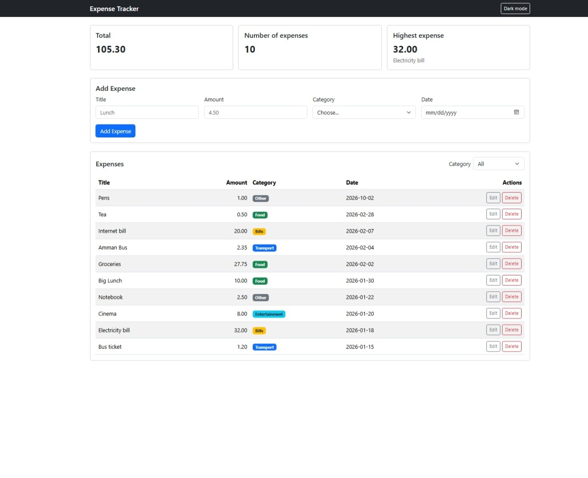
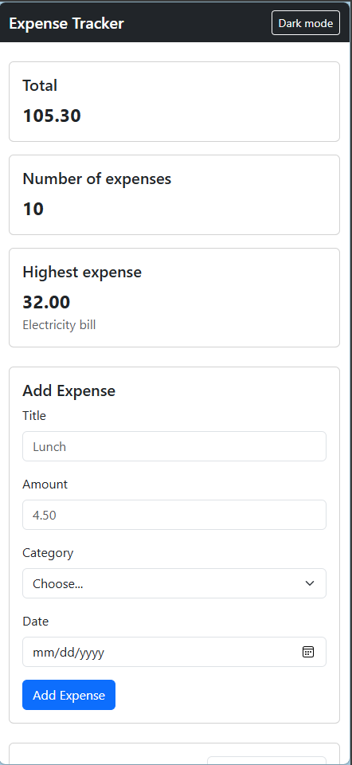
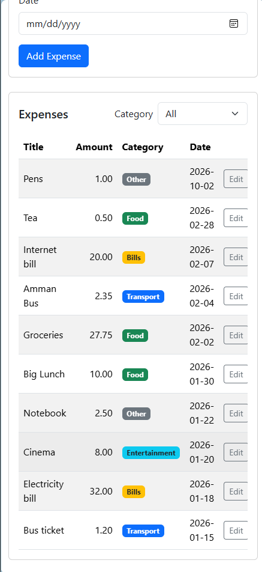

# Expense Tracker

A small web app to record daily expenses. You can add, edit, delete and filter expenses, see a quick summary, and everything is saved in a PostgreSQL database through an Express API.

## How to run

You need Node.js, PostgreSQL (with pgAdmin) and VS Code with the Live Server extension.

**Backend**

1. Open pgAdmin and create an empty database named `expense_tracker`.
2. Right-click `expense_tracker` → **Query Tool**, open `backend/schema.sql`, and run it (F5). This creates the `expenses` table and adds sample data.
3. In the `backend` folder, copy `.env.example` to a new file named `.env` and write your PostgreSQL password in `DB_PASSWORD`.
4. Open a terminal in the `backend` folder and install the packages:
   ```bash
   npm install
   ```
5. Start the server and keep it running:
   ```bash
   node server.js
   ```
   You should see `Server running on http://localhost:3000`.

**Frontend**

1. Make sure the backend is running.
2. In VS Code, right-click `frontend/index.html` → **Open with Live Server**.

## API

| Method | Path | Description | Success | Errors |
|---|---|---|---|---|
| GET | `/api/expenses` | Get all expenses | 200 | — |
| GET | `/api/expenses/:id` | Get one expense | 200 | 404 |
| POST | `/api/expenses` | Add an expense | 201 | 400 |
| PUT | `/api/expenses/:id` | Update an expense | 200 | 400, 404 |
| DELETE | `/api/expenses/:id` | Delete an expense | 200 | 404 |

## Features

- [x] Add an expense (with validation)
- [x] Delete an expense
- [x] Edit an expense
- [x] Filter by category
- [x] Summary cards (total, count, highest)
- [x] Data is saved in a PostgreSQL database
- [x] Bonus: Dark mode

## Screenshots

**Desktop**



**Mobile**




## What was the hardest part?

The hardest part was connecting the pieces together. At first the browser blocked my requests with a CORS error, and even after installing the `cors` package it still failed, because I had put `app.use(cors())` after the routes. I learned that Express reads the code from top to bottom, so middleware must come before the routes. I also got stuck when the server could not connect to the database because of a "password authentication failed" error: I was using the pgAdmin master password instead of the `postgres` user password. Reading the exact error message in the terminal helped me find the real cause each time.


## Video link


https://drive.google.com/file/d/11eb4tYlshoiT-QaFUoP2tzvCPKsQyPIZ/view?usp=sharing